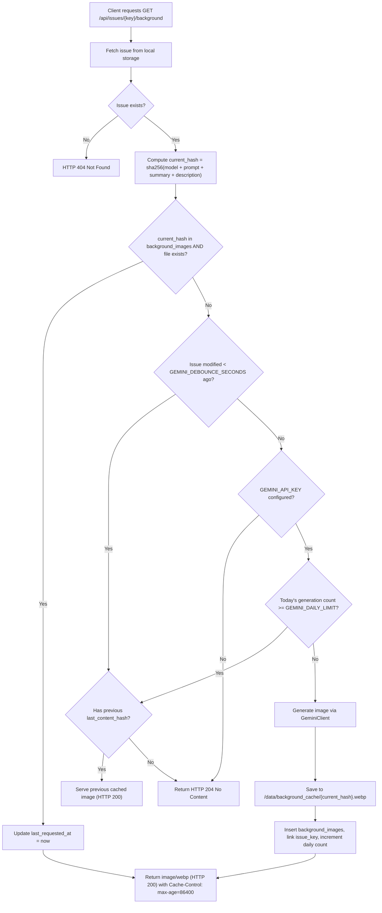

# Design Document: Gemini AI Task Backgrounds for Children

**Date:** 2026-10-10  
**Status:** Draft / Pending Review  
**Author:** Pair Programming Agent & Jacek Marchwicki  

---

## 1. Overview & Objectives

This feature enables AI-generated, kid-friendly illustration backgrounds for individual tasks on the Home Assistant Jira Dashboard. The primary goal is to help children easily understand chores and tasks visually without reading heavy text, while keeping operational costs virtually zero through aggressive content-addressed caching, debounce settling, hard daily usage caps, and graceful degradation.

### Key Requirements & Constraints
1. **Google GenAI Integration**: Utilizes the modern `google-genai` SDK (`from google import genai`) with default model `gemini-3.1-flash-lite-image`, configurable via `GEMINI_MODEL`.
2. **Strict Budget & Cost Controls**:
   - Optional feature: if `GEMINI_API_KEY` is unset or empty, the dashboard cleanly displays default card backgrounds without errors.
   - Configurable daily limit (`GEMINI_DAILY_LIMIT`, default: 100 images/day).
   - If an image fails to generate or daily limit is hit, zero UI breakage occurs—cards render default styles.
3. **Content-Addressed Deduplication & Caching**:
   - Content hash: SHA-256 over `(model + prompt_template + normalized_summary + normalized_description)`.
   - Tasks with identical descriptions share the exact same cached image file on disk.
   - Cache retained for at least 30 days (`GEMINI_CACHE_RETENTION_SECONDS`, default: 2,592,000s = 30 days). Images unrequested for >30 days are automatically pruned to prevent disk bloat.
   - Cache directory is fixed internally to `/data/background_cache` (production) or `backend/data/background_cache` (development fallback).
4. **Debounce Settling for Frequently Edited Tasks**:
   - `GEMINI_DEBOUNCE_SECONDS` (default: 300s = 5 minutes).
   - If a task is modified within the debounce window, the endpoint serves the previous cached image (or 204 No Content if none exists yet), preventing wasted generation while descriptions are actively drafted.
5. **Aspect Ratio & Card Readability Overlay**:
   - Aspect ratio is optimized for Kanban cards (~16:9 landscape).
   - High-contrast, semi-transparent gradient overlay guarantees 100% WCAG AAA text readability over bright and colorful illustrations.
   - Exact same generated image and URL are reused between the board card ([`IssueCard.tsx`](file:///Users/jacek/Documents/apps/jacek-marchwicki/homeassistant-jira/frontend/src/components/IssueCard.tsx)) and the task details modal ([`EditIssueModal.tsx`](file:///Users/jacek/Documents/apps/jacek-marchwicki/homeassistant-jira/frontend/src/components/EditIssueModal.tsx)).
6. **Testing & Test Mocking**:
   - Automated tests never call external Google APIs.
   - Full acceptance criteria integration tests verify debounce, deduplication, rate limits, pruning, and error resilience.

---

## 2. Configuration & Settings

Settings are loaded in [`config.py`](file:///Users/jacek/Documents/apps/jacek-marchwicki/homeassistant-jira/backend/src/jira_dashboard/config.py) from Home Assistant `/data/options.json` and environment variables:

| Setting Field | Env Variable | Default Value | Description |
|---|---|---|---|
| `gemini_api_key` | `GEMINI_API_KEY` | `None` | Google GenAI API key. If unset, background generation is disabled. |
| `gemini_model` | `GEMINI_MODEL` | `"gemini-3.1-flash-lite-image"` | Gemini image generation model identifier. |
| `gemini_prompt_template` | `GEMINI_PROMPT_TEMPLATE` | `"A simple, colorful, kid-friendly storybook illustration depicting the chore or activity: '{summary}'. Clean shapes, gentle lighting, playful and clear visual cues for children, minimal background distractions, no text or words in the image."` | Base prompt template passed to Gemini. |
| `gemini_daily_limit` | `GEMINI_DAILY_LIMIT` | `100` | Maximum new images allowed per calendar day. |
| `gemini_debounce_seconds` | `GEMINI_DEBOUNCE_SECONDS` | `300` | Settle time required after task modification before generating new image. |
| `gemini_cache_retention_seconds` | `GEMINI_CACHE_RETENTION_SECONDS` | `2592000` | Expiration window (30 days) after which unrequested images are purged. |

*Note: The cache directory is fixed internally to `/data/background_cache` (production) or `backend/data/background_cache` (dev/testing) and is not user-configurable.*

---

## 3. Data Model & Storage Schema

SQLite database schema managed in [`storage.py`](file:///Users/jacek/Documents/apps/jacek-marchwicki/homeassistant-jira/backend/src/jira_dashboard/adapters/storage.py):

```sql
-- Cached images and metadata
CREATE TABLE IF NOT EXISTS background_images (
    content_hash TEXT PRIMARY KEY,
    file_path TEXT NOT NULL,
    created_at REAL NOT NULL,
    last_requested_at REAL NOT NULL,
    byte_size INTEGER NOT NULL
);

-- Link tracking the latest generated image for an issue (used for serving previous images during debounce)
CREATE TABLE IF NOT EXISTS issue_background_links (
    issue_key TEXT PRIMARY KEY,
    last_content_hash TEXT NOT NULL,
    updated_at REAL NOT NULL,
    FOREIGN KEY(last_content_hash) REFERENCES background_images(content_hash) ON DELETE CASCADE
);

-- Daily rate limiting tracker
CREATE TABLE IF NOT EXISTS gemini_daily_usage (
    usage_date TEXT PRIMARY KEY, -- 'YYYY-MM-DD'
    generation_count INTEGER NOT NULL DEFAULT 0
);
```

### Automatic 30-Day Cache Pruning
Executed during periodic cleanup, daily maintenance, and startup:
```sql
DELETE FROM background_images 
WHERE last_requested_at < (:now - :retention_seconds);
```
Expired image files on disk are unlinked. Foreign key cascade cleans up orphaned links in `issue_background_links`.

---

## 4. Google GenAI Client Architecture

A dedicated adapter in `backend/src/jira_dashboard/adapters/gemini_client.py`:

```python
class GeminiImageClient(ABC):
    @abstractmethod
    async def generate_image(self, prompt: str, aspect_ratio: str = "16:9") -> bytes | None:
        """Generate image bytes from prompt, returning image/webp or image/jpeg binary data."""
        pass
```

### Real Implementation (`GoogleGenAIImageClient`)
Uses `from google import genai`:
```python
from google import genai
from google.genai import types

class GoogleGenAIImageClient(GeminiImageClient):
    def __init__(self, api_key: str, model: str):
        self._client = genai.Client(api_key=api_key)
        self._model = model

    async def generate_image(self, prompt: str, aspect_ratio: str = "16:9") -> bytes | None:
        # Calls client.models.generate_images(...) asynchronously or via thread executor
        ...
```

### Mock Implementation (`MockGeminiImageClient`)
Used in all automated test suites and when running in fake/mock mode (`JIRA_USE_FAKE=1` or `TESTING=1`):
- Returns a lightweight valid image byte payload (1x1 or test image).
- Keeps call counts for test assertions.
- Requires no network connectivity and incurs $0 cost.

---

## 5. API Endpoint Workflow: `GET /api/issues/{key}/background`



---

## 6. Frontend Presentation & Visual Overlay

### 1. Kanban Board & People Board (`IssueCard.tsx`)
- Cards load with the default background token `var(--jira-surface-elevated)`.
- If background image is enabled, the card applies a CSS background layer:
  ```css
  background-image: 
    linear-gradient(to bottom, rgba(17, 24, 39, 0.78), rgba(17, 24, 39, 0.90)),
    url('/api/issues/${issue.key}/background');
  background-size: cover;
  background-position: center;
  background-repeat: no-repeat;
  ```
- **Light Theme Support**:
  ```css
  background-image: 
    linear-gradient(to bottom, rgba(255, 255, 255, 0.82), rgba(255, 255, 255, 0.92)),
    url('/api/issues/${issue.key}/background');
  ```
- **Text & UI Elements**:
  - Summaries and labels have enhanced drop-shadow and semantic high-contrast text tokens.
  - Interactive buttons (Quick Done, Edit, Status Select) retain full pointer event accessibility and minimum $44 \times 44\text{px}$ touch targets.

### 2. Task Details Screen (`EditIssueModal.tsx`)
- Reuses the identical background URL: `/api/issues/${issue.key}/background`.
- Rendered in the top modal header / dialog backdrop banner with the same gradient readability overlay.
- Zero extra images generated.

### 3. Graceful Degradation
- If `GET /api/issues/{key}/background` returns `204 No Content`, `404`, or fails due to network outage, the card seamlessly renders standard background styling with zero visual glitches or layout shifts.

---

## 7. Testing & Acceptance Criteria

### Acceptance Criteria Integration Tests
1. **Deduplication Test**:
   - Create two tasks with identical summaries and descriptions (`"Clean the bedroom"`).
   - Request background for Task 1: Gemini client is invoked once.
   - Request background for Task 2: Gemini client is NOT invoked; Task 2 serves the exact same image and content hash as Task 1.
2. **Debounce Settling Test**:
   - Update Task 1's description.
   - Request background immediately (< 5 minutes): endpoint serves the previous image and does NOT invoke Gemini client.
   - Fast-forward time past `GEMINI_DEBOUNCE_SECONDS`: next request generates the new image and updates `issue_background_links`.
3. **Daily Quota Cap Test**:
   - Set daily limit to 2.
   - Generate images for 2 distinct tasks.
   - Request image for 3rd distinct task: returns 204 No Content; Gemini client is not called.
4. **30-Day Cache Pruning Test**:
   - Insert cached image record with `last_requested_at` 31 days in the past.
   - Run pruning routine: database row and file on disk are deleted.
5. **Disabled Feature Test**:
   - With `GEMINI_API_KEY` unset, `GET /api/issues/{key}/background` returns 204 No Content.

### Visual Regression & Local CI Tests
- Vitest unit tests for `IssueCard` and `EditIssueModal` background rendering and overlay styling.
- Playwright screenshot tests in `frontend/tests/visual/screenshots.spec.ts` capturing cards with background images.
- Full verification through `./scripts/run_ci_locally.py` passing with 100% success.
