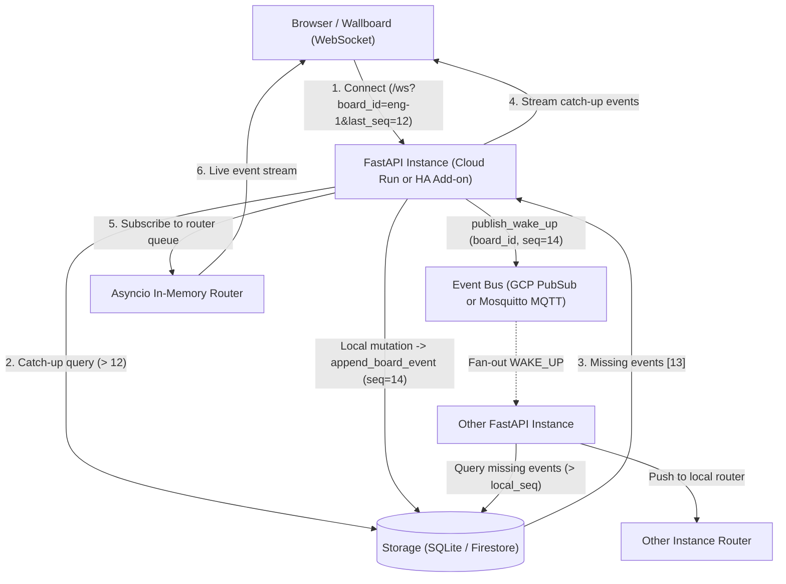

# PubSub (GCP), MQTT (Home Assistant) and Outbox Architecture Design

**Date:** 2026-11-11  
**Task:** HOME-15405: Zaimplementować architekturę PubSub dla GCP i MQTT dla Home Assistant  
**Status:** Approved  

---

## 1. Overview & Goals

This specification details a distributed event notification and synchronization architecture for the Home Assistant Jira Dashboard. It addresses multi-instance synchronization on GCP Cloud Run and local home automation eventing on Home Assistant, while guaranteeing zero message loss and strictly ordered event delivery to WebSocket clients via an Outbox event stream.

### Key Objectives
1. **Board-Level Monotonic Event Ordering**: Provide sequential, gapless event numbering per board (`seq = 1, 2, 3...`) using row-level locking/atomic transactions in SQLite and Firestore.
2. **Multi-Instance Cloud Run Fan-Out (GCP Pub/Sub)**: Instances listen to a lightweight `WAKE_UP` signal via ephemeral GCP Pub/Sub subscriptions.
3. **Home Assistant Add-on Eventing (Mosquitto MQTT)**: Support native local broker communication via MQTT for the `WAKE_UP` signal, unified under the same event bus abstraction.
4. **WebSocket Catch-Up & Live Stream**: Web clients retrieve un-synced events on connect or reconnect from the database before subscribing to a live in-memory `asyncio` event router.

---

## 2. Architecture & Data Flow



---

## 3. Storage & Sequence Control (Outbox Pattern)

### 3.1 Schema Definition
Existing storage engines (SQLite for HA / standalone and Firestore for Cloud Run) are extended with two core structures:

#### SQLite Schema
```sql
CREATE TABLE IF NOT EXISTS board_streams (
    board_id TEXT PRIMARY KEY,
    current_seq INTEGER NOT NULL DEFAULT 0,
    updated_at TEXT NOT NULL
);

CREATE TABLE IF NOT EXISTS outbox_events (
    id INTEGER PRIMARY KEY AUTOINCREMENT,
    board_id TEXT NOT NULL,
    seq INTEGER NOT NULL,
    event_type TEXT NOT NULL,
    payload TEXT NOT NULL,
    created_at TEXT NOT NULL,
    UNIQUE(board_id, seq)
);

CREATE INDEX IF NOT EXISTS idx_outbox_events_board_seq ON outbox_events(board_id, seq);
```

#### Firestore Data Model
* Collection: `board_streams/{board_id}`:
  * Document fields: `{"current_seq": int, "updated_at": str}`
* Subcollection: `board_streams/{board_id}/events/{seq}`:
  * Document fields: `{"seq": int, "event_type": str, "payload": dict, "created_at": str}`

### 3.2 Storage Protocol Methods (`StorageProtocol`)
The `StorageProtocol` class in `jira_dashboard/adapters/storage_protocol.py` is extended with:

```python
def append_board_event(
    self,
    board_id: str,
    event_type: str,
    payload: dict[str, Any],
) -> int:
    """Atomically increments current_seq for board_id and records the event in outbox_events.
    
    Returns the newly allocated monotonic sequence number.
    """
    ...

def get_board_events_since(
    self,
    board_id: str,
    since_seq: int,
    limit: int = 100,
) -> list[dict[str, Any]]:
    """Returns events for board_id strictly newer than since_seq ordered by seq ASC."""
    ...

def get_latest_board_seq(self, board_id: str) -> int:
    """Returns the current sequence number for board_id (defaults to 0 if none exist)."""
    ...
```

---

## 4. Pluggable Event Bus (`EventBusProtocol`)

### 4.1 Interface Specification
In `jira_dashboard/adapters/event_bus.py`:

```python
class EventBusProtocol(Protocol):
    async def publish_wake_up(self, board_id: str, seq: int) -> None:
        """Publishes a WAKE_UP signal with board_id and sequence number."""
        ...

    async def start_listening(
        self, on_wake_up: Callable[[str, int], Awaitable[None]]
    ) -> None:
        """Starts background listener for WAKE_UP notifications."""
        ...

    async def stop_listening(self) -> None:
        """Stops background listeners and cleans up subscriptions/connections."""
        ...
```

### 4.2 Message Format
`WAKE_UP` payload is lightweight JSON:
```json
{
  "type": "WAKE_UP",
  "board_id": "engineering-1",
  "seq": 42,
  "source_instance": "instance-550e8400-e29b-41d4-a716-446655440000"
}
```

### 4.3 Adapters

#### 1. GCP Pub/Sub (`GCPPubSubEventBus`)
* **Target Environment**: GCP Cloud Run multi-instance deployments.
* **Topic**: `projects/{project_id}/topics/{topic_name}` (from `settings.gcp_pubsub_topic`).
* **Ephemeral Subscription**: On `start_listening()`, generates a subscription ID:
  `projects/{project_id}/subscriptions/run-{instance_id}-{timestamp}`.
* Configures message retention (1 hour) and automatic expiration after 24 hours of inactivity.
* On `stop_listening()`, cancels the subscriber and deletes the subscription.

#### 2. Mosquitto MQTT (`MosquittoMQTTEventBus`)
* **Target Environment**: Home Assistant Add-on and local home automation setups.
* **Broker**: Connects using `paho-mqtt` or `asyncio-mqtt` / raw asyncio MQTT protocol to `settings.mqtt_broker_url` (default: `mqtt://core-mosquitto:1883` or `MQTT_URL`).
* **Topic**: `homeassistant/jira_dashboard/events/wake_up`.
* Subscribes on `start_listening()`, parsing incoming `WAKE_UP` messages.

#### 3. In-Memory (`InMemoryEventBus`)
* **Target Environment**: Unit tests, integration tests, and standalone deployments without GCP or MQTT.
* Maintains an internal list of registered callbacks and dispatches `publish_wake_up` directly within the process using `asyncio.create_task`.

#### 4. Bus Factory (`create_event_bus`)
```python
def create_event_bus(settings: JiraDashboardSettings) -> EventBusProtocol:
    if settings.event_bus_backend == "pubsub" or (
        settings.event_bus_backend is None and settings.auth_mode == "gcp_oauth"
    ):
        return GCPPubSubEventBus(settings)
    if settings.event_bus_backend == "mqtt" or (
        settings.mqtt_broker_url is not None or os.environ.get("MQTT_URL")
    ):
        return MosquittoMQTTEventBus(settings)
    return InMemoryEventBus()
```

---

## 5. In-Memory `asyncio` Event Router & WebSocket Catch-Up

### 5.1 `AsyncioEventRouter`
In `jira_dashboard/presentation/event_router.py`:
* Maintains `_subscribers: dict[str, set[asyncio.Queue[dict[str, Any]]]]` keyed by `board_id`.
* Tracks `_last_dispatched_seq: dict[str, int]` per board.
* `subscribe(board_id: str) -> asyncio.Queue[dict[str, Any]]`: Registers a new client queue.
* `unsubscribe(board_id: str, queue: asyncio.Queue[dict[str, Any]]) -> None`: Unregisters a client queue.
* `async handle_wake_up(board_id: str, seq: int) -> None`:
  1. Compares `seq` with `_last_dispatched_seq.get(board_id, 0)`.
  2. If `seq > last_seq`, queries `storage.get_board_events_since(board_id, since_seq=last_seq)`.
  3. Iterates through events, placing each onto the queues of all subscribers for `board_id`.
  4. Updates `_last_dispatched_seq[board_id] = event["seq"]`.

### 5.2 WebSocket Endpoint (`/ws`) Protocol
1. Client connects to `/ws?board_id=engineering-1&last_seq=10`.
2. **Catch-Up**:
   * If `last_seq` is provided:
     ```python
     missed = storage.get_board_events_since(board_id, since_seq=last_seq)
     for ev in missed:
         await websocket.send_json({
             "event": "outbox_delta",
             "board_id": board_id,
             "seq": ev["seq"],
             "type": ev["event_type"],
             "payload": ev["payload"],
         })
     ```
   * Emits catch-up completion marker:
     ```json
     {
       "event": "catchup_complete",
       "board_id": "engineering-1",
       "synced_seq": 13
     }
     ```
3. **Live Streaming**:
   * Subscribes connection queue via `router.subscribe(board_id)`.
   * Forwards live events from the queue to the client.
   * Handles client disconnect gracefully by invoking `router.unsubscribe(board_id, queue)`.

---

## 6. Frontend Store Integration (`boardStore.ts`)

* State property: `lastSeenSeq: number | null` (persisted or tracked per board).
* On WebSocket handshake: append `?board_id=${boardId}&last_seq=${lastSeenSeq ?? 0}`.
* When message with `"event": "outbox_delta"` arrives:
  1. Apply issue update / delta to board state.
  2. Update `lastSeenSeq = Math.max(lastSeenSeq ?? 0, event.seq)`.

---

## 7. Verification & Testing Strategy

1. **Storage Unit Tests**:
   * `backend/tests/test_board_outbox_storage.py`:
     * Test atomic monotonic increment of `current_seq`.
     * Test unique constraint rejecting duplicate `(board_id, seq)` pairs.
     * Test `get_board_events_since` pagination and ordering.
2. **Event Bus Unit Tests**:
   * `backend/tests/test_event_bus.py`:
     * `InMemoryEventBus`: verify publication triggers callbacks across subscribers.
     * `GCPPubSubEventBus` (mocked client): verify topic publication, ephemeral subscription creation and teardown.
     * `MosquittoMQTTEventBus` (mocked broker): verify connection, subscribe to topic, and message handling.
3. **Asyncio Router & WebSocket Catch-Up Tests**:
   * `backend/tests/test_websocket_outbox_catchup.py`:
     * Connect client with `last_seq = 0` when events exist in DB; verify catch-up events arrive in order followed by `catchup_complete`.
     * Test live event broadcast via `handle_wake_up`.
     * Test reconnecting client catching up on missed events during disconnect.
4. **Local CI Verification**:
   * Run `./scripts/run_ci_locally.py` to ensure 100% passing tests and strict Ruff/TypeScript compliance.
