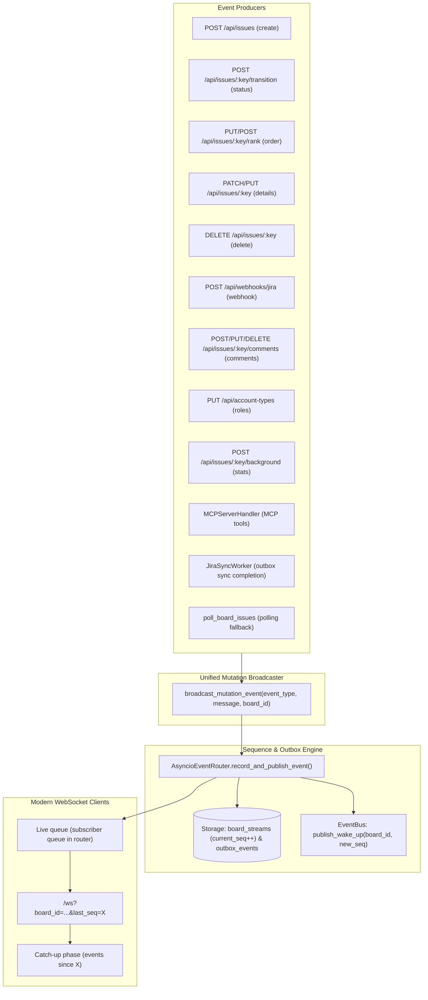

# Specification: Unified Modern WebSocket Outbox Sequences Architecture

**Date:** 2026-11-11  
**Status:** In Review  
**Task:** Migrate all WebSocket broadcasts to Modern Clients using monotonic outbox sequence numbers

---

## 1. Overview & Objectives

Currently, the backend maintains two separate WebSocket delivery mechanisms:
1. **Modern / Sequenced Clients (`/ws?last_seq=...`):** Connected via `event_router`, receiving strictly ordered, persistent `outbox_delta` envelopes containing monotonic sequence numbers (`seq`).
2. **Legacy Clients (`/ws` without `last_seq`):** Receiving raw, unsequenced JSON broadcasts via `ws_hub.broadcast()`.

This creates major issues:
- Mutations triggered via webhook (`/api/webhooks/jira`), deletions (`DELETE /api/issues/{key}`), comments, account types, stats, and MCP server actions bypass sequence assignment and are dropped entirely for modern clients because `ws_hub.broadcast` skips `subscribed_connections`.
- There is split logic in `WebSocketHub` with `subscribed_connections` tracking.
- Clients connecting without `last_seq` have no recovery mechanism on reconnect.

### Goals
1. **Mandatory `last_seq`:** `/ws` requires a valid `last_seq` integer query parameter (e.g., `/ws?last_seq=0` or `/ws?board_id=HOME&last_seq=12`). Connections without it are rejected immediately (WebSocket close code `1008 Policy Violation` with reason `"Missing or invalid required query parameter: last_seq"`).
2. **100% Monotonic Sequencing:** Every single state change in the application (creation, update, status change, rank change, deletion, webhook ingest, comments, account types, Gemini stats, MCP actions) MUST be assigned a monotonic sequence number via `append_board_event` and published through `event_router.record_and_publish_event`.
3. **Elimination of Legacy Broadcasting:** Remove `ws_hub.broadcast()`, `subscribed_connections`, and `mark_router_subscribed()` from `WebSocketHub`. `WebSocketHub` becomes solely an active connection manager. All WebSocket traffic is delivered as standard `outbox_delta` envelopes from `event_router`.
4. **Test Suite Migration:** Update all tests (integration, webhook, websocket, unit) to supply `last_seq` and expect `outbox_delta` envelopes.

---

## 2. Architecture & Data Flow



---

## 3. Detailed Specifications

### 3.1 WebSocket Endpoint Contract (`/ws`)

1. **Query Parameters:**
   - `board_id` (string, optional): Board identifier. Defaults to `settings.jira_board_id`.
   - `last_seq` (**integer, required**): The sequence number of the last event processed by the client. Must be an integer $\ge 0$.
2. **Validation:**
   - If `last_seq` is missing:
     ```python
     await websocket.close(
         code=status.WS_1008_POLICY_VIOLATION,
         reason="Missing required query parameter: last_seq",
     )
     return
     ```
   - If `last_seq` is not a valid integer or $< 0$:
     ```python
     await websocket.close(
         code=status.WS_1008_POLICY_VIOLATION,
         reason="Invalid query parameter: last_seq must be a non-negative integer",
     )
     return
     ```
3. **Lifecycle:**
   - On valid connection:
     1. Accept socket and register with `ws_hub.connect(websocket)`.
     2. Send initial connection greeting:
        ```json
        {
          "event": "connected",
          "message": "Connected to Home Assistant Jira Dashboard WebSocket Hub",
          "active_clients": 1,
          "board_id": "HOME"
        }
        ```
     3. Subscribe to `event_router.subscribe(board_id)`.
     4. Query `storage.get_board_events_since(board_id=board_id, since_seq=last_seq, limit=1000)`.
     5. Deliver each missed event as `outbox_delta`:
        ```json
        {
          "event": "outbox_delta",
          "board_id": "HOME",
          "seq": 14,
          "type": "issue_transitioned",
          "payload": { ... },
          "created_at": "2026-11-11T20:00:00Z"
        }
        ```
     6. Send `catchup_complete`:
        ```json
        {
          "event": "catchup_complete",
          "board_id": "HOME",
          "synced_seq": 14
        }
        ```
     7. Concurrently stream events from `queue.get()` to the client as `outbox_delta` messages, and listen for client text (`"ping"` -> `"pong"`).
     8. In `finally` block: `event_router.unsubscribe(board_id, queue)` and `ws_hub.disconnect(websocket)`.

### 3.2 Simplification of `WebSocketHub`

- `active_connections: list[WebSocket]` is maintained for connection tracking / metrics (`active_clients`).
- `subscribed_connections` set is **deleted**.
- `mark_router_subscribed()` is **deleted**.
- `broadcast()` is **deleted**. All event distribution is handled via `AsyncioEventRouter`.

### 3.3 Unified Mutation Broadcaster (`broadcast_mutation_event`)

```python
async def broadcast_mutation_event(
    event_type: str,
    message: dict[str, Any],
    board_id: str | None = None,
) -> None:
    """Record outbox event in storage, publish WAKE_UP via EventBus, and dispatch to WS router."""
    b_id = board_id or settings.jira_board_id
    await event_router.record_and_publish_event(
        board_id=b_id,
        event_type=event_type,
        payload=message,
    )
```

### 3.4 Migration of All Event Sources

| Endpoint / Component | Event Type | Payload |
| :--- | :--- | :--- |
| `POST /api/webhooks/jira` (deleted) | `issue_deleted` | `{"event": "issue_deleted", "issue_key": del_key}` |
| `POST /api/webhooks/jira` (created/updated) | `issue_created` / `issue_transitioned` | `{"event": event_type, "issue_key": issue.key, "status_category": ..., "issue": issue.model_dump()}` |
| `DELETE /api/issues/{key}` | `issue_deleted` | `{"event": "issue_deleted", "issue_key": key}` |
| `POST /api/issues/{key}/transition` | `issue_transitioned` | `{"event": "issue_transitioned", ...}` |
| `POST /api/issues` | `issue_created` | `{"event": "issue_created", ...}` |
| `PUT/POST /api/issues/{key}/rank` | `issue_ranked` | `{"event": "issue_ranked", ...}` |
| `PATCH/PUT /api/issues/{key}` | `issue_updated` | `{"event": "issue_updated", ...}` |
| `POST /api/issues/{key}/comments` | `comment_created` | `{"event": "comment_created", "issue_key": key, "comment": ...}` |
| `PUT /api/issues/{key}/comments/{id}` | `comment_updated` | `{"event": "comment_updated", "issue_key": key, "comment": ...}` |
| `DELETE /api/issues/{key}/comments/{id}` | `comment_deleted` | `{"event": "comment_deleted", "issue_key": key, "comment_id": ...}` |
| `PUT /api/account-types` | `account_types_updated` | `{"event": "account_types_updated", "account_types": updated}` |
| `POST /api/issues/{key}/background` | `gemini_stats_updated` | `{"event": "gemini_stats_updated", "gemini_stats": ...}` |
| `MCPServerHandler` | `issue_created`, `issue_transitioned`, `issue_updated`, `comment_created` | Passes `broadcast_mutation_event` |
| `poll_board_issues` | `issue_transitioned` | Calls `broadcast_mutation_event` |

---

## 4. Frontend & Testing Compatibility

### 4.1 Frontend (`App.tsx` & `boardStore.ts`)
- In `App.tsx`, the WebSocket connection already passes `last_seq=${lastSeq}`:
  ```typescript
  const lastSeq = state.lastSeenSeq ?? 0;
  queryParams.push(`last_seq=${lastSeq}`);
  ```
- In `boardStore.ts`, incoming `outbox_delta` envelopes are already un-nested:
  ```typescript
  if (msg.event === 'outbox_delta') {
    if (typeof msg.seq === 'number') {
      set((state) => ({
        lastSeenSeq: Math.max(state.lastSeenSeq ?? 0, msg.seq as number),
      }));
    }
    if (msg.payload && typeof msg.payload === 'object') {
      get().handleWsMessage(msg.payload);
    }
    return;
  }
  ```
- Because every payload (including `issue_deleted`, `comment_*`, and `account_types_updated`) will now arrive wrapped in `outbox_delta`, `boardStore.handleWsMessage(msg.payload)` automatically unpacks and processes them.

### 4.2 Test Suite Updates
- `backend/tests/test_websocket_outbox_catchup.py`: Already tests `last_seq` and `outbox_delta`. Add tests verifying missing/invalid `last_seq` is rejected with WS close code 1008.
- `backend/tests/test_integration.py`: Update WebSocket helper to connect with `?last_seq=0` and consume `outbox_delta` envelopes.
- `backend/tests/test_webhook_verification.py`: Verify that incoming webhooks produce outbox events with incremented sequence numbers and deliver `outbox_delta` over WebSocket.
- Any other tests connecting to `/ws`: Append `?last_seq=0`.
